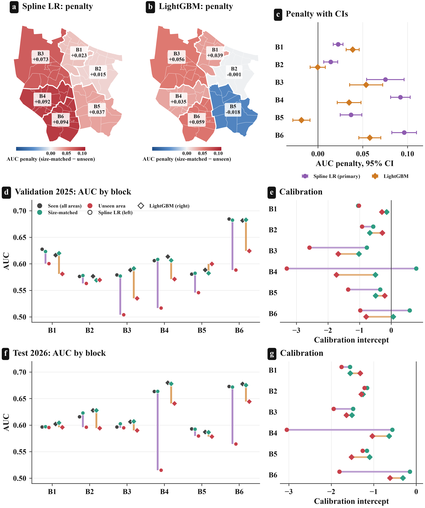
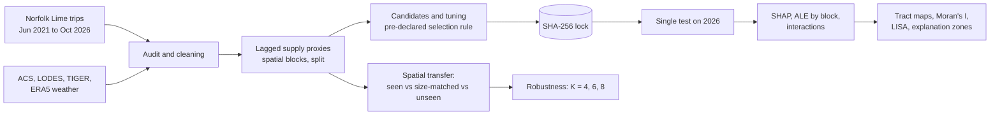

<div align="center">

# Where riders choose e-bikes over e-scooters

### Spatial transferability and explainable machine learning in a dockless mixed fleet

**Lime, Norfolk, Virginia · 4.4 million trips · June 2021 to October 2026**


</div>

---

## Overview

Dockless operators increasingly offer e-bikes and e-scooters through one app. This repository contains the complete, reproducible analysis behind the paper *Where riders choose e-bikes over e-scooters*, which asks three questions:

1. **What separates** e-bike trips from e-scooter trips, once fleet supply is controlled for?
2. **Does a model of the choice transfer** to neighborhoods it has not seen, and to a later year?
3. **Where in the city** do the explanations, and the errors, cluster?

The e-bike is a rare outcome (6.3% of trips), so evaluation centers on PR-AUC, lift and calibration. Models are selected on 2025 by a rule fixed in advance and evaluated **once** on 2026 under a SHA-256 model lock. Spatial transferability is tested by holding out six contiguous blocks of census tracts, with a **size-matched control** that separates the cost of spatial novelty from the cost of training on less data.

<div align="center">

<br><sub><b>Spatial transferability.</b> Seen and size-matched models perform alike, yet not having seen an area costs the spline model far more than LightGBM, mostly in the dense central blocks.</sub>
</div>

## Key findings

| | Result |
|---|---|
| Test performance (2026) | Primary spline logit PR-AUC **0.093** (95% CI 0.088 to 0.099), 1.7 times the base rate; LightGBM 0.098 |
| Model selection | Validation log loss differed by 0.0007, below the pre-declared 0.001 margin, so the simpler spline model is primary |
| Spatial transfer (test) | Not having seen an area costs the spline model **0.096 AUC** and LightGBM **0.029** (trip-weighted) |
| Robustness | The spline penalty is 1.8 to 2.6 times that of LightGBM for 4, 6 and 8 blocks |
| Main determinants | Lagged fleet e-bike share, distance from downtown, distance between origin and destination |
| Spatial structure | Moran's I of 0.78 to 0.88 for trip-geometry and destination explanations; 0.58 to 0.66 for residuals |
| Rare-class handling | Class weighting raised the validation calibration intercept to +8.9 and was rejected |

## Study design and leakage control

The analysis protocol ([`PROTOCOL.md`](PROTOCOL.md)) was fixed before modeling. Leakage is prevented by design, and every control is asserted in code:

- **No post-choice variables.** Ridden distance, duration and end time are recorded after the trip and are never features.
- **Pre-trip trip length.** Trip length enters only as the distance between origin and destination tract centroids.
- **Strictly lagged supply proxy.** Fleet supply is unobserved; it is proxied by the citywide e-bike share and trip count over days *t*−7 to *t*−1, verified by a brute-force recomputation.
- **No outcome encoding of places.** Tracts enter only through census attributes; spatial blocks are formed from tract centroids alone.
- **Training-only preprocessing and strict temporal order.** Inner training, a seven-day embargo, a 2025 validation year and a single locked test on 2026.



## Repository structure

```
ebike-escooter-spatial-transfer-norfolk/
├── README.md
├── PROTOCOL.md                  analysis protocol, fixed before modeling
├── CITATION.cff                 how to cite this repository
├── LICENSE                      MIT (code)
├── requirements.txt             pinned Python dependencies
├── run_all.sh                   runs the full pipeline in order
├── configs/
│   ├── config.yaml              data source, paths, audit limits
│   └── features.json            feature sets (written by step 01)
├── data/
│   └── README.md                how to obtain every input
├── src/
│   ├── prep_01_data_audit.py ... prep_03_clean_and_features.py   data preparation
│   ├── step_01_prepare.py ... step_10_manuscript_tables.py       study pipeline
│   ├── common.py                paths, loading, metrics
│   └── fstudio.py, plots.py, plots_extra.py   figure design system
└── outputs/
    ├── tables/                  all result tables (CSV)
    ├── reports/                 preparation summary, model selection, test lock, XAI summary (JSON)
    ├── figures/{png,pdf}/       Figures 1 to 10
    └── manuscript_tables/       LaTeX tables generated from saved results
```

## Reproducing the analysis

**1. Environment** (Python 3.13)

```bash
python -m venv .venv
source .venv/bin/activate          # Windows: .venv\Scripts\activate
pip install -r requirements.txt
```

**2. Data.** Download the inputs listed in [`data/README.md`](data/README.md). All inputs are public.

**3. Run** the pipeline from the repository root, in order:

| Step | Script | Purpose |
|---|---|---|
| 1 | `prep_01_data_audit.py` | Audit the raw trip file (structure, missing values, plausibility flags) |
| 2 | `prep_02_external_data.py` | Census tracts, ACS 2019 to 2023, LODES 2022, hourly ERA5 weather |
| 3 | `prep_03_clean_and_features.py` | Clean trips, attach time, weather and tract context |
| 4 | `step_01_prepare.py` | Lagged supply proxies, spatial blocks, training-only correlation filter, temporal split |
| 5 | `step_02_candidates.py --set main` (and `main_plus_history`, `origin_only`) | Untuned candidate models on validation |
| 6 | `step_03_tune_select.py --set main` (and `main_plus_history`) | Optuna tuning and the pre-declared selection rule |
| 7 | `step_04_descriptive_figures.py` | Figures 1 to 4 |
| 8 | `step_05_spatial_transfer.py` | Seen, size-matched and unseen models for each block (validation) |
| 9 | `step_06_test_once.py` | **Single** evaluation on 2026, including spatial transfer on the test year |
| 10 | `step_07_xai_spatial.py` | SHAP for both models, tract profiles, Moran's I, LISA, explanation zones |
| 11 | `step_08_model_figures.py` | Figures 5 to 10 |
| 12 | `step_09_robust_blocks.py` | Spatial transfer with K = 4 and K = 8 blocks |
| 13 | `step_10_manuscript_tables.py` | LaTeX tables for the manuscript |

Or simply run `bash run_all.sh`. A full run takes several hours on a laptop; the test-set step can only be run once per set of locked models.

## Outputs and the manuscript

| Manuscript item | File |
|---|---|
| Figures 1 to 10 | `outputs/figures/png/Fig01_*.png` ... `Fig10_*.png` (PDF versions in `outputs/figures/pdf/`) |
| Figure captions | `outputs/figures/figure_captions.md` |
| Predictive performance | `outputs/tables/T04_*.csv`, `T05_*.csv`, `T07_test_overall.csv`, `T08_test_by_group.csv` |
| Spatial transferability | `outputs/tables/T06_spatial_transfer_valid.csv`, `T10_spatial_transfer_test.csv`, `T15_block_sensitivity.csv` |
| Explanations and spatial structure | `outputs/tables/T11_shap_importance.csv`, `T12_moran.csv`, `T13_zones.csv`, `T14_interactions.csv` |
| Model lock | `outputs/reports/06_TEST_LOCK.json` (SHA-256 of every locked model) |

## Citation

If you use this code, please cite the paper and the repository (see [`CITATION.cff`](CITATION.cff)):

> Hassan, M. (2026). *Where riders choose e-bikes over e-scooters: Spatial transferability and explainable machine learning in a dockless mixed fleet.* Manuscript under review.

## Data licenses

Trip records are published by the City of Norfolk on its [open data portal](https://data.norfolk.gov/Government/Micromobility-Electric-Scooters-and-Bikes-/wqxq-hhe6). Census data (ACS, LODES, TIGER/Line) are public domain. Weather data come from the Open-Meteo historical API (ERA5 reanalysis, CC BY 4.0). The code in this repository is released under the MIT License.

## Contact

Mahbub Hassan · [mahbub.fkta@gmail.com](mailto:mahbub.fkta@gmail.com)
